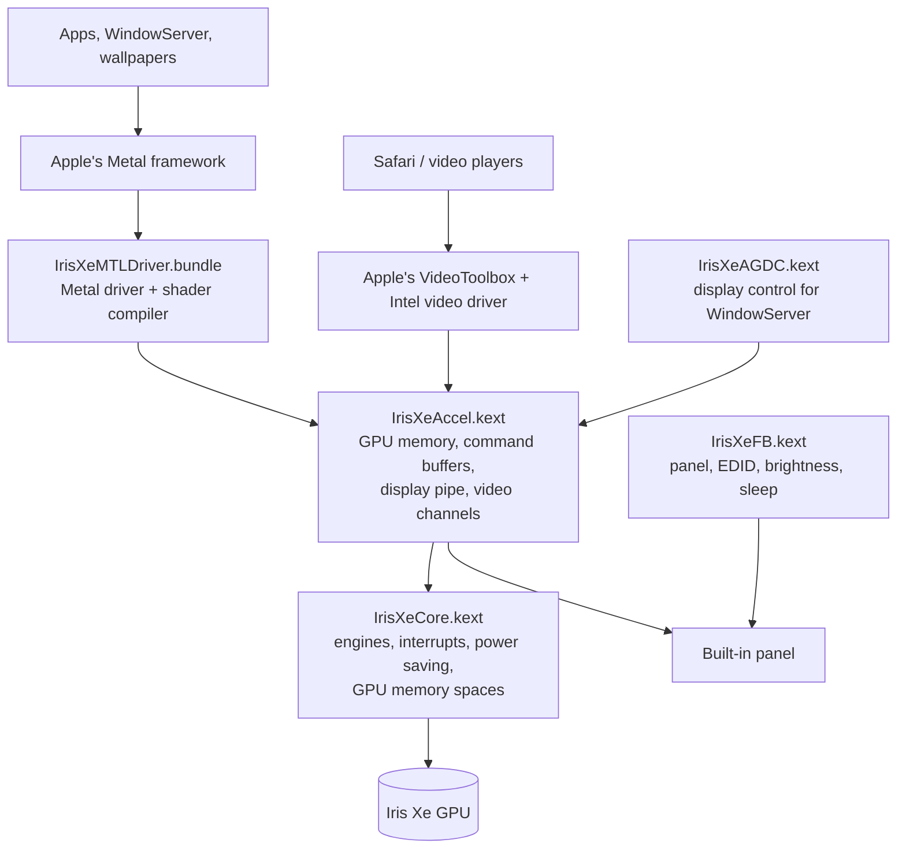

# IrisXe-Driver-MacOs

An open-source macOS driver for Intel Tiger Lake Iris Xe graphics (PCI ID `8086:9a49`) on Hackintosh laptops. It is built for macOS Sequoia and designed to stay compatible with Tahoe. Apple never made a driver for this GPU, so this one is built from Intel's public documentation and the open-source Linux driver.

☕ Support the project: https://buymeacoffee.com/zep245

## Progress

Rough estimates, updated with each build (v0.68.40):

```
Display (panel, HiDPI, EDID)       ████████████████████ 100%
Brightness, sleep and wake         █████████████████░░░  85%
GPU-drawn desktop (from boot)      ██████████████████░░  90%
Metal for apps                     █████████████░░░░░░░  65%
Hardware video decoding            ███████░░░░░░░░░░░░░  35%
Full acceleration overall          ███████████████░░░░░  75%
```

### Working

- ✅ Built-in panel at its native resolution, with HiDPI modes
- ✅ Brightness keys and slider, display sleep, system sleep and wake (the slider shows full after a restart: being fixed)
- ✅ The GPU draws the whole desktop from boot: smooth animations, transparency and blur
- ✅ Metal: compute, drawing, textures, our own shader compiler (Metal shaders → Iris Xe code)
- ✅ Live wallpapers (Sequoia, Macintosh)
- ✅ GPU power saving (RC6) and clock control

### In progress

- 🚧 Hardware video decoding (YouTube without heat). macOS now finds the GPU's H.264 decoder and opens it. Next: running the decode on the GPU's video engine. This is a test-boot feature for now.
- 🚧 Opening the lid does not wake the laptop (press a key or the trackpad); needs an OpenCore ACPI patch, not the GPU driver
- 🚧 Metal for every app (today only the desktop, wallpapers and listed apps use the GPU)

## How it works



| Part | What it does | Installed to |
|---|---|---|
| `IrisXeCore.kext` | Starts the GPU: render, copy and video engines, interrupts, power saving, GPU memory | OpenCore `EFI/OC/Kexts` |
| `IrisXeFB.kext` | Drives the built-in panel: resolution, HiDPI, brightness, sleep | `/Library/Extensions` |
| `IrisXeAccel.kext` | Makes the GPU usable by Metal and video; shows the desktop on the panel | `/Library/Extensions` |
| `IrisXeAGDC.kext` | Display control that WindowServer needs for the GPU desktop | `/Library/Extensions` |
| `IrisXeMTLDriver.bundle` | The Metal driver and shader compiler apps load | `/Library/GPUBundles` |

## Install

You need: a Tiger Lake laptop with Iris Xe (`8086:9a49`), macOS Sequoia, and OpenCore.

**1. Build.** Upload this source to your GitHub repository. Open **Actions → IrisXe build → Run workflow**, enter the version (for example `0.68.40`) and run it. Download the `IrisXe-<version>` artifact and unzip it.

**2. First time only: add IrisXeCore to OpenCore.** In `EFI/OC/config.plist`, under **Kernel → Add**, add an entry:

| Key | Value |
|---|---|
| `BundlePath` | `IrisXeCore.kext` |
| `ExecutablePath` | `Contents/MacOS/IrisXeCore` |
| `PlistPath` | `Contents/Info.plist` |
| `Enabled` | `true` |

**3. Add the boot-args** (see below), in `config.plist` under **NVRAM → Add → 7C436110-AB2A-4BBB-A880-FE41995C9F82 → boot-args**.

**4. Install.** Open Terminal in the unzipped folder and run:

```
bash install-all.sh
```

It installs everything in one go and asks for your password.

**5. Allow and restart.** If macOS asks, open **System Settings → Privacy & Security**, click **Allow** for the IrisXe kexts, then restart.

After the restart, the GPU draws the desktop.

## Boot-args

Required:

```
-irisxefb -irisxegpu -irisxeaccel -irisxemetal
```

Keep your other boot-args in front, for example `keepsyms=1 -irisxefb -irisxegpu -irisxeaccel -irisxemetal`.

Useful extras:

| Boot-arg | Does |
|---|---|
| `-irisxeoff` | Safe mode: all IrisXe kexts do nothing. Add it from OpenCore's boot menu if a build doesn't start |
| `-irisxecpu` | CPU-drawn desktop (GPU desktop off) |
| `-irisxedemo` | Show the old GPU test colour bars on the boot screen |

<details>
<summary>All fallback switches (only if something goes wrong)</summary>

| Boot-arg | Effect |
|---|---|
| `-irisxecopy` | GPU desktop: copy each frame with the CPU instead of showing it directly |
| `-irisxelowva` | Programs get 512 MB of GPU addresses instead of 3.5 GB |
| `-irisxenobatch` | One draw per GPU job |
| `-irisxeasync` | Asynchronous command buffers on |
| `-irisxeflush` | Smart flushing between draws on |
| `irisxebatch=8` | Up to 8 draws per GPU job |
| `-irisxenovmask` | No helper pixels at triangle edges |
| `-irisxenoshadow` | Build draw state directly in GPU memory |
| `-irisxebatchfull` | Batched jobs repeat the full setup for every draw |
| `-irisxenohash` | No pixel pipe balancing table |
| `-irisxeuc` | Ring and draw pages uncached |
| `-irisxenoboost` | GPU clock left to the hardware |
| `-irisxenorc6` | GPU deep sleep (RC6) off |
| `-irisxenorcs` | Render engine not used |
| `-irisxenomocs` / `-irisxenopat` / `-irisxenoringfreq` | GPU cache / page-table cache / ring clock tables left as the firmware set them |
| `-irisxenoreset` | No automatic GPU reset after a hang |
| `-irisxenosleep` | Blocks system sleep |
| `-irisxenostageb` | Display sleep only turns the backlight off |
| `-irisxenorestore` | No display rebuild after system sleep |
| `-irisxenobl` / `-irisxenobldelay` | No backlight control / no backlight start-up delay |
| `-irisxenodpms` | Display power states not sent to the panel |
| `-irisxenoedid` / `-irisxenosnap` | Don't read the panel's EDID / don't snapshot the boot display registers |
| `-irisxehwcursor` | Hardware mouse pointer (testing) |
| `-irisxeapplepipe` | Apple's own display pipe object instead of ours (testing) |

</details>

## Troubleshooting

- **The Mac doesn't start after installing:** in OpenCore's boot menu add `-irisxeoff`, start macOS, and install the previous build again.
- **Old kexts still load after installing:** open **System Settings → Privacy & Security**, click **Allow**, and restart.
- **The GPU doesn't start:** check that `EFI/OC/Kexts/IrisXeCore.kext` is complete (run `install-core.sh` again; it checks the copy).

<details>
<summary>Advanced: test tools, live switches, status</summary>

**Test scripts** (in the build folder):

| Script | Tests |
|---|---|
| `sudo bash irisxe-fulltest.sh` | Speed, memory and the GPU desktop; results in `~/Downloads/irisxe-results` |
| `sudo bash irisxe-videorecord.sh prepare` | Hardware video decoding test (one boot): run, restart, then run it again without `prepare` |
| `sudo bash irisxe-wallpapertest.sh` | Live wallpapers on the GPU |
| `./irisxe-metaltest --missing` | Metal calls apps made that the driver doesn't handle yet |

**Live switches** (`sudo sysctl ...`): `debug.irisxe_scanout=0` copies frames instead of showing them directly; `debug.irisxe_async=0/1` asynchronous command buffers (on by default since v0.68.33, from 90 s after boot; boot-arg `-irisxenoasync` turns it off); `debug.irisxe_batch=N` draws per GPU job (6 by default since v0.68.35, from 90 s after boot; boot-arg `irisxebatch=N`). `debug.irisxe_worker=0/1` the GPU worker: a kernel thread runs the draws so programs don't wait for the GPU (on since v0.68.40; boot-arg `-irisxenoworker`). Chromium / Electron GPU processes (Brave, Claude, GitHub Desktop, VS Code ...) stay on their own software renderer unless named in `irisxe-apps`.

**Apps on the GPU:** list program names, one per line, in `/Library/Preferences/irisxe-apps`.

**Status:**

```
ioreg -l -w0 | grep -E '"IrisXe-(GPU|GPUFreq|DisplayPipe|FrameTiming|AccelVersion|GPUDesktop)"'
```

</details>

## Legal

This project contains no Apple code. Hardware knowledge comes from Intel's public documentation and the open-source Linux i915 driver. Apple interfaces are documented clean-room style, from names and observed behaviour.
